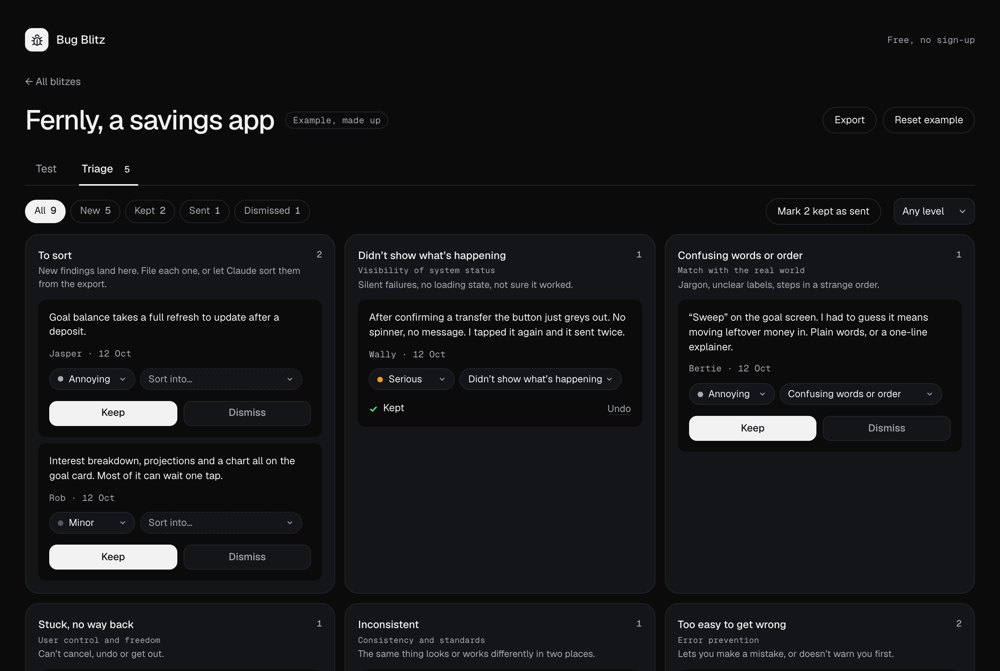

# Bug Blitz

[](https://github.com/DanUrq/bugblitz/actions/workflows/ci.yml)

A free mini app for running a bug blitz. Your team walks the same core flows on a working build for 30 minutes and says what tripped them up, in plain words. You sort what matters, and Claude can file the tickets in Linear.

Try it: [urquhart.design/bugblitz](https://www.urquhart.design/bugblitz/). How it works: [the guide](https://www.urquhart.design/bugblitz/docs/).



## What it does

- **Set up in two minutes.** Name the product, link the build, list the flows, pick the minutes per tester.
- **Share one link.** Testers add a name and they're in. No accounts. Private blitzes work only through their link; open ones are listed for anyone to join, up to a cap.
- **Test.** A timer, the flows checklist, and a note box: what you did, what you expected, what happened, with a screenshot if it helps (drop or paste). Testers say how bad it is in plain words (Minor, Annoying, Serious, Blocks me) and never have to classify anything.
- **Triage.** Findings land in To sort. Each card asks one thing: keep it or dismiss it. File them into plain categories, each mapped to one of Nielsen's usability heuristics.
- **Tickets.** Export the findings as Markdown, give them to Claude with the [Bug Blitz skill](skill/bug-blitz-tickets/SKILL.md) and a tracker connector (Linear, GitHub Issues, Jira), and it drafts the tickets, shows you the plan, and only then creates and assigns them.

Everyone with the link sees the same board, updating every few seconds. Without a server, a blitz works on one device and the export works the same.

## Run it locally

```bash
npm install
npm run dev
```

Open http://localhost:5300. Shared blitzes live in memory until the server stops.

```bash
npm test        # the logic and the API
npm run lint    # ESLint and Prettier
```

## Deploy your own

It's a static page plus one serverless function, built for [Vercel](https://vercel.com):

1. Import the repo into Vercel. No build step is needed.
2. In the project's **Storage** tab, add **Upstash for Redis** (the free plan is enough) and a **Blob** store with **Private** access, connected to all environments.
3. Deploy.

The function reads these variables, which connecting the stores sets for you:

| Variable | What it's for |
| --- | --- |
| `UPSTASH_REDIS_KV_REST_API_URL`, `UPSTASH_REDIS_KV_REST_API_TOKEN` | The blitzes and findings. `KV_REST_API_URL` / `KV_REST_API_TOKEN` work too. |
| `BLOB_STORE_ID` | Screenshots, in a private store, served through the function. |
| `BUG_BLITZ_ADMIN_KEY` | Optional. Lets you unlist or delete any open blitz. |

### Limits and data

- Every blitz deletes itself, screenshots included, seven days after its last change. The creator can delete it sooner with their admin link.
- Up to 20 testers per blitz (open blitzes can set fewer), 300 findings, screenshots up to 700 KB (the app scales them down first).
- Boards poll a revision number every 4 seconds while visible and in use. A 30-minute blitz with 8 testers costs about 3,600 Redis commands, against Upstash's free 500,000 a month.
- New blitzes and writes are rate-limited per IP.

## Embed it

The app is plain JavaScript modules, with no dependencies in the browser:

```js
import { mountBugBlitz } from './src/view.js';

mountBugBlitz(document.getElementById('app'), {
  storageKey: 'bug-blitz',    // where this browser keeps its blitzes
  routing: 'hash',            // 'hash' puts the view in the address; 'memory' keeps it inside (an embed)
  appUrl: null,               // the app's address, for invite links (defaults to this page)
  docsUrl: null,              // a guide to link from the home (none by default)
  className: '',              // a class on the app, for theming
});
```

Theme it by setting the `--bb-*` custom properties on `.bb-app` (see `src/style.js` and `index.html`).

## The Claude skill

[`skill/bug-blitz-tickets/SKILL.md`](skill/bug-blitz-tickets/SKILL.md) turns an export into tickets. It sorts anything unsorted, merges duplicates, maps how bad each finding is to a priority, skips findings already ticketed, shows you the plan, and creates nothing until you say yes. Testers' notes are treated as data, never as instructions.

- **Claude app:** add the Linear connector in Settings, then upload the `skill/bug-blitz-tickets` folder, zipped, as a skill.
- **Claude Code:** `claude mcp add --transport http linear-server https://mcp.linear.app/mcp`, then copy the folder to `~/.claude/skills/`.

## Layout

```
index.html            the standalone page
src/core.js           the rules: blitzes, findings, triage, the timer, the export, the store
src/view.js           the app: state, actions and events
src/templates.js      the app's HTML
src/routes.js         the addresses (#/new, #/b/<id>, #/r/<room>)
src/sync.js           the line to the server
src/image.js          screenshots, scaled down
src/style.js          the styles, themed by --bb-* properties
src/copy.js           the home and setup copy
src/sample.js         the example blitz (a made-up savings app)
server/handler.js     the API: who may do what, and what it does
server/stores.js      Redis (Upstash) and private Blob, or memory for development
api/blitz.js          the Vercel function, wiring the two together
skill/                the Claude skill
dev.mjs               the local server
```

The rules live once, in `src/core.js`: the app and the server both use them.

## Contributing

Issues and pull requests are welcome. See [CONTRIBUTING.md](CONTRIBUTING.md), and report security problems privately ([SECURITY.md](SECURITY.md)).

## License

[MIT](LICENSE). Geist and Geist Mono are by Vercel, under the [SIL Open Font License](fonts/OFL.txt).

Made by [Daniel Urquhart](https://www.urquhart.design/).
